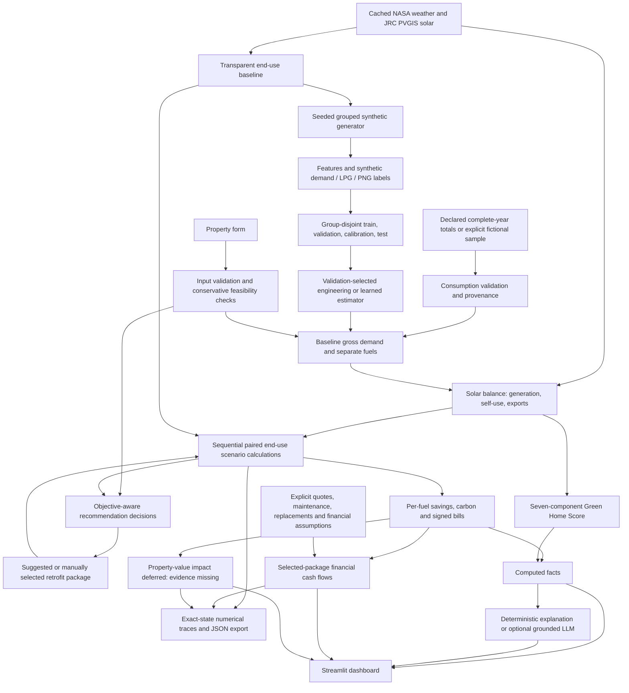

# Architecture

The prototype targets a Hyderabad residential pilot, with exploratory configurations for seven other cities. Electricity demand, solar flows, LPG and PNG are separate. The condensed brief's seven score weights and per-fuel accounting rules are retained.

Annual-consumption mode bypasses the predictor and anchors the engineering calculation to complete-year user totals. Active-fuel fields start blank, and partial-year or missing totals withhold calculation. Fictional and model demonstration origins remain explicit. Bill totals do not meter appliance shares or validate retrofit savings.

Baseline model targets are gross electricity demand, LPG and PNG. Solar is excluded from regression features and applied afterward through one shared energy balance. A physical candidate competes with learned estimators on validation data; calibration is separate from selection and test. Repeated household/building groups stay in one partition.

Retrofit scenarios edit physical attributes and apply paired end-use ratios to the same anchored baseline. The model has not learned causal effects from observed before-and-after homes. A frozen external RESIDE-AC audit is kept outside training; missing features prevent full real-data validation.

A what-if selection changes the package, reruns the scenario engine, records exact before/after states and then refreshes explanations from the new computed facts. Standalone, selected-package marginal and all-feasible-reference traces share the scenario engine's calculation path. The explanation layer does not calculate scores, savings, carbon or property values.

`greenhome/retrofit_engine.py` ranks by an explicit bill, purchased-energy or operational CO₂ objective. It proposes candidate additions, calls the existing scenario engine for each package, and retains the greatest positive incremental benefit. Decision selection order and canonical installation order remain distinct. The API always enables preliminary PV site screening. No additional regression model is introduced.

`greenhome/finance.py` consumes the selected scenario and its shared bill trace. It uses incremental quotes only for applied measures, then calculates cash flows from the entered horizon, rates, maintenance, replacements and any explicitly confirmed solar subsidy. Costs do not feed back into the retrofit rankings. **Costs & payback** presents annual bill estimates and lifetime financial NPV as cash-flow results. Property-value impact is deferred because verified local transactions linked to known retrofit histories and comparable-property controls are missing; exports preserve the deferral reason. The dashboard has no valuation or hypothetical premium controls. An experimental percentage-sensitivity helper remains only for API compatibility, outside the dashboard flow shown here. See `docs/financial_module.md` for equations and `docs/property_value_scope.md` for the deferred scope.

The source, generated data, split identifiers, fitted model, evaluation reports and held-out predictions travel with the prototype so a judge can inspect and reproduce a run.
